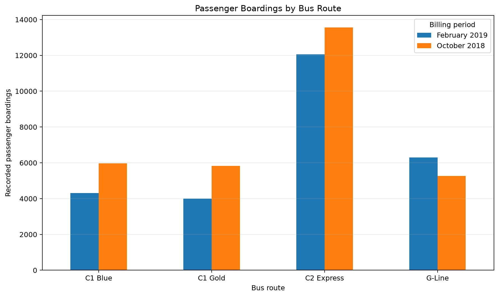
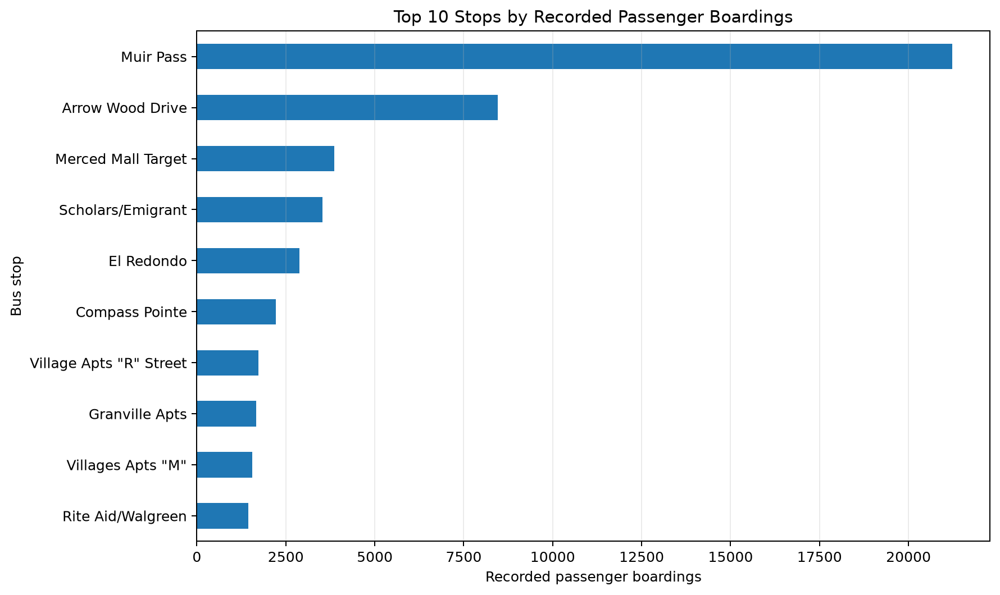
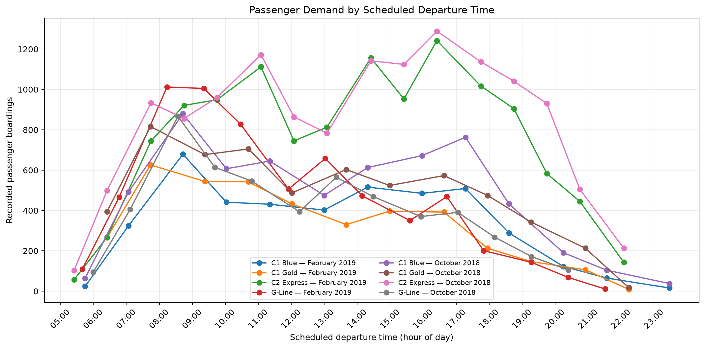
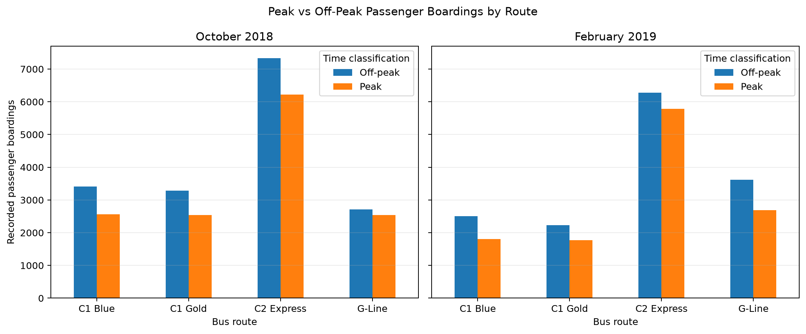
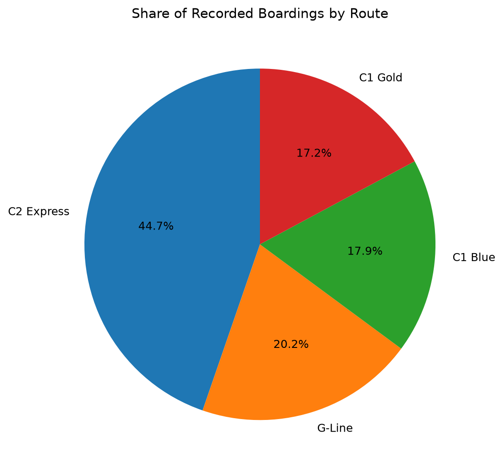

# DA-012 — Public Transport Ridership Analysis

**Subject:** Data Analytics  
**Project ID:** DA-012  
**Case study:** UC Merced CatTracks campus bus system  
**Tools:** Python, Pandas, NumPy, Matplotlib, Plotly, Streamlit, OpenPyXL, Jupyter Notebook

## Project overview

This project analyses aggregate passenger boarding data from the University of California, Merced's CatTracks bus system. It focuses on four weekday routes — C1 Blue, C1 Gold, C2 Express, and G-Line — and compares two billing periods represented in the source workbooks: October 2018 and February 2019.

The analysis converts the workbooks' aggregate `PAX ON` tables into a tidy dataset and examines route-level demand, stop-level demand, scheduled departure-time patterns, and peak versus off-peak boardings.

## Project objectives

1. Load and inspect public bus ridership workbooks.
2. Extract and clean aggregate passenger boarding counts.
3. Compare recorded demand across four routes and two billing periods.
4. Identify stops with the highest recorded boarding counts.
5. Examine demand by scheduled departure time.
6. Compare boarding totals in predefined peak and off-peak windows.
7. Present findings using reproducible tables and visualisations.

## Repository structure

```text
DA-012-Public-Transport-Analytics/
├── data/
│   ├── CATTRACKS Fall 2018- October Billing.xlsx
│   ├── 219-CATTRACKS Fall 2019- February Billing.xlsx
│   ├── team_members.csv            # Public names/roles only
│   └── team_members_private.csv    # Local-only IDs/roll numbers; Git-ignored
├── app.py                         # Interactive Streamlit dashboard
├── .streamlit/
│   └── config.toml                # Dashboard theme
├── DASHBOARD_GUIDE.md              # Dashboard setup and usage
├── GEOSPATIAL_DATA_NOTES.md        # Map source/date/accuracy notes
├── MAP_WORKSPACE_GUIDE.md         # Map-led interactive workflow
├── notebooks/
│   └── DA012_Ridership_Analysis.ipynb
├── outputs/
│   ├── charts/
│   └── tables/
├── src/
│   ├── ridership_analysis.py
│   └── geospatial.py               # GTFS and historical stop geocoding
├── tests/
│   ├── test_analysis.py
│   └── test_geospatial.py
├── upstream_reference/
│   ├── notebooks/
│   ├── src/
│   └── UPSTREAM_README.md
├── DATA_DICTIONARY.md
├── LICENSE
├── NOTICE.md
├── README.md
├── requirements.txt
└── run_analysis.py
```

## Setup and execution

Python 3.10 or newer is recommended.

### 1. Create and activate a virtual environment

**macOS / Linux**

```bash
python3 -m venv .venv
source .venv/bin/activate
```

**Windows**

```powershell
py -m venv .venv
.venv\Scripts\activate
```

### 2. Install dependencies

```bash
python -m pip install --upgrade pip
pip install -r requirements.txt
```

### 3. Run the complete analysis

From the repository root:

```bash
python run_analysis.py
```

The script creates CSV summary tables in `outputs/tables/` and PNG charts in `outputs/charts/`.

To run the extraction regression checks:

```bash
python -m unittest discover -s tests
```

### 4. Launch the interactive dashboard

```bash
streamlit run app.py
```

The dashboard opens in your browser at a local address (normally `http://localhost:8501`). Use the sidebar to filter by billing period, route, time-of-day band, peak/off-peak classification, and scheduled departure hour. The dashboard includes an author-branded interface, KPI cards, generated insights, interactive route and stop comparisons, time-pattern charts, a route-by-hour heatmap, and a searchable CSV data explorer. Filters update the displayed metrics and visualisations. See `DASHBOARD_GUIDE.md` for details.

### 5. Open the Jupyter Notebook

```bash
jupyter notebook notebooks/DA012_Ridership_Analysis.ipynb
```

Run the notebook cells from top to bottom. The notebook and dashboard use the same data-extraction module.


## Dashboard author

The adapted DA-012 dashboard displays the project author as **Shoaib**. The author credit appears in the dashboard header, sidebar, and footer.

## Interactive dashboard

The Streamlit dashboard is branded for the DA-012 student project and displays the author credit **Shoaib**. Its filters update five KPI cards, generated selection-specific insights, route/stop comparisons, time-of-day charts, a route-by-hour heatmap, and the searchable data explorer. Filtered records can be downloaded as CSV.

Launch it from the project root after activating `.venv`:

```bash
python -m streamlit run app.py
```

See `DASHBOARD_GUIDE.md` for details.

## Methodology

### Data extraction

The supplied Excel worksheets contain several side-by-side weekday blocks and an aggregate `PAX ON` table. The original notebooks use fixed column slices that are difficult to maintain. This adaptation detects the right-most aggregate table dynamically, reads its scheduled departure-time columns, and converts the stop-level values into a tidy Pandas DataFrame.

### Data preparation

- Normalise route labels and whitespace in stop names.
- Convert Excel time codes (for example, `545`) into `HH:MM` strings.
- Convert passenger counts to numeric values.
- Exclude missing, non-numeric, negative, and zero-count observations from the tidy analysis table.
- Combine repeated stop names within the same route, billing period, and departure time.
- Derive time bands and a Peak / Off-peak label.

### Peak-hour definition

For this analysis, peak windows are predefined as **07:00–09:59** and **16:00–18:59**. All other departure times are classified as off-peak. These windows are explicit project assumptions and can be changed in `src/ridership_analysis.py`.

## Visualisation previews

**Route comparison**



**Busiest stops**



**Demand by departure time**



**Peak versus off-peak**



**Route demand share**



## Visualisations

The run creates five charts:

1. Passenger boardings by bus route and billing period.
2. Top 10 stops by recorded passenger boardings.
3. Passenger demand by scheduled departure time.
4. Peak versus off-peak boardings by route.
5. Share of recorded boardings by route.

### Current analysis outputs

The extracted route totals are:

| Billing period | C1 Blue | C1 Gold | C2 Express | G-Line | All four routes |
|---|---:|---:|---:|---:|---:|
| October 2018 | 5,976 | 5,829 | 13,552 | 5,261 | 30,618 |
| February 2019 | 4,304 | 4,005 | 12,053 | 6,299 | 26,661 |

These values were checked against the corresponding `TOTAL` column in each workbook's aggregate `PAX ON` table. All eight route-period totals matched.

The figures above are recorded billing-period totals. They are **not normalised for the number of operating days**, so they should not be presented as evidence of month-on-month growth or decline.

## Limitations

- The analysis covers four selected weekday routes, not the entire CatTracks network.
- The supplied data are historical billing-period aggregates, not real-time or passenger-level records.
- The workbook's aggregate table does not provide enough information here to make a daily or weekend-versus-weekday comparison.
- `PAX ON` counts represent boardings, not unique individuals; the same person may board more than once.
- Peak windows are project-defined assumptions.
- Differences between the two billing periods may reflect operating-day counts, schedules, calendar effects, or other factors not controlled for in this analysis.

## Upstream project and attribution

This work is an adaptation of **UCM CatTracks Simulator**. The original notebooks and Python source files are retained under `upstream_reference/` for comparison; the active DA-012 workflow uses the new parser and analysis notebook in this repository.

- Original repository: https://github.com/nlt-python/UCM_CatTracks_Simulator
- The upstream README states that the project is licensed under the Creative Commons Attribution 4.0 International licence (CC BY 4.0): https://creativecommons.org/licenses/by/4.0/

This adaptation retains attribution to the upstream project and identifies the additional extraction, cleaning, summary, and visualisation work in `NOTICE.md`. The source Excel files are included unchanged. See `NOTICE.md` for details.

## Suggested viva explanation

The project uses Python and Pandas to convert semi-structured Excel worksheets into a tidy ridership dataset. It then groups passenger boarding counts by route, stop, scheduled departure time, and billing period. Matplotlib is used to visualise route demand, busiest stops, time-of-day patterns, and peak/off-peak differences. The goal is descriptive analysis of the available data rather than prediction or causal claims.

## Map-led geospatial transit analysis

The Streamlit application opens on a **map-led Geospatial Analysis workspace**. It uses a map + analytics split view: select a historical route or stop, explore the boarding-weighted heatmap, and inspect period comparisons and scheduled-hour patterns beside the map. A separate GTFS view draws actual route paths when the loaded feed contains `shapes.txt` linked to trips.

### Historical ridership map — October 2018 and February 2019

- Filter the map by historical route and billing period.
- Change marker size to represent the selected boarding count.
- Toggle the passenger demand heatmap. Heat intensity is weighted by recorded boarding counts.
- Click a stop marker or choose a stop in the inspector to update period comparison, route contribution and departure-hour charts.
- Choose theme-matched, light, dark or standard OpenStreetMap tiles.

The historical workbooks contain stop labels and boarding counts, but not latitude/longitude or vector route geometry. OpenStreetMap Nominatim matches are approximate place/intersection locations, not surveyed stop poles. The location cache is local at `data/stop_locations_osm.csv` and excluded from Git.

### Actual route lines from GTFS

The dashboard can load the official CatTracks static GTFS ZIP by download or upload. When the feed contains a valid `shapes.txt` linked to `trips.txt`, the dashboard draws those **actual GTFS route shapes**, shows GTFS stop markers, and lets the user inspect route/stop details and stop sequence. It will not invent route lines if shape geometry is missing.

The archived CatTracks GTFS snapshot checked for this project lists service beginning **2023-08-15**. These route lines can be overlaid on the historical demand map as a separate later-network reference, but they must not be described as exact 2018–19 alignments.

The historical route context is documented in the **UC Merced 2020 LRDP Transportation Impact Analysis** prepared in August 2019. Figure 2 is titled *Weekday Bus Routes* and describes C1, C2 and G corridors. It is a static reference map, not a downloadable vector geometry layer. This project does not fabricate historical route polylines. See [the official assessment](https://planning.ucmerced.edu/sites/g/files/ufvvjh1431/f/page/documents/appendix_4.8_uc_merced_2020_lrdp_transportation_impact_analysis_rev.pdf) and `GEOSPATIAL_DATA_NOTES.md`.

### Geospatial data sources

- Historical route context: [UC Merced 2020 LRDP Transportation Impact Analysis (August 2019)](https://planning.ucmerced.edu/sites/g/files/ufvvjh1431/f/page/documents/appendix_4.8_uc_merced_2020_lrdp_transportation_impact_analysis_rev.pdf).
- Current route reference: [UC Merced TAPS routes](https://taps.ucmerced.edu/node/4656) and [Transitland CatTracks feed archive](https://www.transit.land/data/feeds/f-cattracks~ca~us).
- Historical stop-name geocoding: [OpenStreetMap Nominatim](https://nominatim.openstreetmap.org/). Map data attribution is shown on the map.

See `MAP_WORKSPACE_GUIDE.md` for the new map workflow, `DASHBOARD_GUIDE.md` for full setup steps, and `GEOSPATIAL_DATA_NOTES.md` for date, source and location-quality limitations.

## Project team

The dashboard includes the official project metadata and the 11-person roster. The public `data/team_members.csv` contains names and general project roles. Student IDs and roll numbers are stored in `data/team_members_private.csv`, which is excluded by `.gitignore` for local academic use only. **Do not force-add that private file to a public Git repository.** Obtain team members' consent before publishing their names.

Academic details: Invertis University, Bareilly · B.Tech · Semester III · Section F · Group BTech_DA_08 · Mentor Puneet Arora.


## Map and sidebar configuration

- **Global filters** are collapsed in the sidebar. Expand the section to choose billing periods using checkboxes, routes, time bands, demand class and departure-hour range.
- **Map appearance** is a separate sidebar section; basemap settings are never hidden inside the map. Standard OpenStreetMap is the default and needs no API key.
- Optional **CARTO Positron (light)** and **CARTO Dark Matter** styles are enabled after entering a free non-commercial key in the sidebar. The current non-commercial tier allows up to 5 million tile requests per calendar month. Request a key at <https://www.carto.com/basemaps/apikey/>.
- The map saves its centre and zoom through the Streamlit-Folium component callback before a rerun, so ordinary pan/zoom and filter changes preserve the viewport. Use **Fit visible stops** only when you want to reframe.
- The Geospatial Analysis page uses a shorter map beside a route/stop inspector, followed by a full-width row of billing-period and scheduled-hour analysis to avoid a large blank area under the map.

For OSM tile usage, keep attribution visible and use normal interactive viewing only; do not bulk-download or prefetch tiles. See the [OpenStreetMap Tile Usage Policy](https://operations.osmfoundation.org/policies/tiles/) and [MAP_TROUBLESHOOTING.md](MAP_TROUBLESHOOTING.md).
